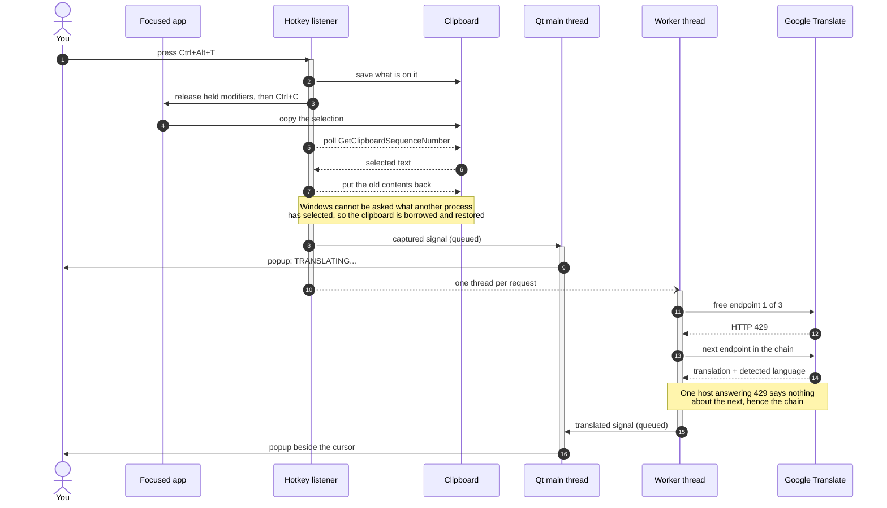

# win-translate

A background tray app for Windows and macOS. Select text in any application,
press a hotkey, and a small popup shows the translation next to the cursor:
English in, Vietnamese out — and Vietnamese in, English out.

## Download and install

Ready-made downloads are on the
[Releases page](https://github.com/thanhnvse/win-translate/releases/latest).
They carry everything the app needs; nothing else has to be installed first —
no Python, no git.

### macOS

macOS 13 or later. The fastest way is one line in Terminal, which downloads
the latest release, puts it in Applications and starts it — and, because it
does not go through a browser, macOS does not ask for "Open Anyway":

```bash
curl -fsSL https://raw.githubusercontent.com/thanhnvse/win-translate/main/scripts/install-macos.sh | sh
```

Run the same line again to update. To install by hand instead:

1. Download `win-translate-<version>-macos-arm64.dmg` for Apple silicon, or
   `…-macos-x86_64.dmg` for an Intel Mac (Apple menu → About This Mac shows
   which).
2. Open it and drag **win-translate** onto **Applications**, eject the disk
   image, and start the app from Applications.
3. The first time, macOS says it could not verify the app, because it is not
   notarized (kiểm duyệt) by Apple. On macOS 15 and later choose **Done** —
   not Move to Trash — then, within about an hour, open System Settings →
   Privacy & Security, scroll to **Security**, click **Open Anyway**, enter
   your password, and choose **Open** when the question comes back. On macOS
   13 and 14, Control-click the app and choose **Open** instead. Either way
   it is needed once.
4. If macOS offers no Open Anyway — Apple documents the button for apps in
   general, and this one is signed only ad hoc — clear the download mark once
   in Terminal, then start the app again (or use the one-line install above,
   which avoids the mark altogether):

   ```bash
   xattr -dr com.apple.quarantine /Applications/win-translate.app
   ```

On its first start win-translate asks for **Accessibility** permission, which
it needs to copy the selection (see "Accessibility permission" below). Then a
blue **W** appears in the menu bar: select text anywhere and press
**Control+T**.

After an update macOS may refuse the old permission without saying so — the
switch stays on but the popup reports it missing. Remove win-translate from
the Accessibility list with **−**, add it again with **+**, and restart it.
The downloads are signed ad hoc, so each new version looks like a different
app to macOS.

To uninstall, quit it from the menu bar W and drag it from Applications to the
Trash.

### Windows

Windows 10 or 11, 64-bit. Download
`win-translate-<version>-windows-x64-setup.exe` and run it. It installs for
your user only, so it needs no administrator rights; it offers a desktop
shortcut and starting with Windows, and starts the app when it finishes. A
**W** appears in the notification area — possibly hidden under the **^**
arrow: select text and press **Ctrl+Alt+T**.

The installer is not signed with a paid certificate, so Windows warns before
running it:

* Edge may say the file "isn't commonly downloaded": choose **…** → **Keep**
  → **Show more** → **Keep anyway**.
* SmartScreen shows "Windows protected your PC": choose **More info** →
  **Run anyway**. It asks again for each new version.
* On a Windows 11 PC with **Smart App Control** on, unsigned programs are
  blocked with no Run anyway. The choices are to turn Smart App Control off
  (Windows Security → App & browser control) or to build from source, below.

To update, run the new installer; if win-translate is running, it asks you to
close it first.

To uninstall: Settings → Apps → win-translate → Uninstall.

## Why a hotkey and not a right-click menu

The original idea was a "Translate to Vietnamese" entry in the right-click menu
of any selected text. On Windows that is not possible for a third-party app:

* Shell extensions (`IContextMenu`, and `IExplorerCommand` on Windows 11) apply
  to **files and folders in Explorer**, not to a text selection.
* The menu you get when you right-click selected text is drawn by the
  application itself — Chrome renders its own, Word renders its own. Windows
  exposes no supported way to add an item to it.
* The only technical route is DLL injection or a global hook into other
  processes, which antivirus flags, which breaks against elevated and sandboxed
  apps, and which breaks again on the next Chrome update.

So this uses a global hotkey instead, the same approach DeepL and similar tools
take on Windows. A browser extension is the way to get a real right-click entry
inside Chrome or Edge; that is not part of this repo.

On macOS the original idea *is* achievable, through the Services menu
(`NSServices` in `Info.plist`), but only for a bundled `.app`. The macOS build
here uses the same hotkey as Windows instead, so it runs straight from the
source tree like the Windows one does.

## Build from source

For working on the code. Requires Python 3.10+.

Windows:

```bash
python -m venv .venv
.venv\Scripts\python.exe -m pip install -r requirements.txt
```

macOS (also pulls in the PyObjC packages, which are skipped on Windows):

```bash
python3 -m venv .venv.nosync
.venv.nosync/bin/python -m pip install -r requirements.txt
```

The `.nosync` suffix matters when the project sits in a folder iCloud Drive
syncs — `~/Desktop` or `~/Documents` with "Desktop & Documents Folders" on.
iCloud sets the BSD `hidden` flag on every dot-named file and on everything
inside a dot-named directory, within seconds of their creation. Qt's plugin
loader skips hidden files, so a plain `.venv` there starts fine at first and
then fails with *Could not find the Qt platform plugin "cocoa"*. iCloud leaves
anything named `*.nosync` alone — no flag, and no uploading thousands of
package files either. Outside iCloud the suffix is harmless.

## Run on Windows

```bash
.venv\Scripts\pythonw.exe -m wintranslate
```

Use `pythonw.exe` rather than `python.exe` so no console window stays open.
A tray icon appears; the app does nothing else until the hotkey fires.

Default hotkey is **Ctrl+Alt+T**. Select text anywhere, press it, and the popup
appears by the pointer. `Esc`, the `✕`, or clicking elsewhere dismisses it.

The direction is chosen from the text: select English (or anything else) and you
get Vietnamese; select Vietnamese and you get English. One hotkey, both ways.

Or just double-click `start.cmd`.

### Terminals and CLI apps

Apps that take the mouse inside a terminal (Claude Code, vim, tmux, htop...)
select text themselves and copy it to the clipboard when you release the mouse.
The terminal holds no selection, so the Ctrl+C that win-translate sends copies
nothing. You do not need to hold Shift to make the terminal select instead.

The rule is exact: win-translate always sends Ctrl+C. If the clipboard changes,
that is the selection. If it does not change, win-translate uses the text that
is already on the clipboard only when all of these are true:

* it was put there while the window that has focus now had focus,
* it was put there by that window's own program or a program it started (Claude
  Code copies through a short-lived PowerShell), or by a program that has
  already exited, and
* win-translate did not put it there itself (for example with the popup's Copy
  button).

Each such copy is used once; the next press needs a new selection.

So a copy made in another application before you switched to this window is
never used, and neither is a copy another running application makes in the
background while this window has focus, such as a password manager's global
"copy password" hotkey. What can still count is an explicit copy you make in
this same window (for example Ctrl+C on other text), or a copy by a program that
writes to the clipboard and exits straight away.

With nothing selected at all, the Ctrl+C reaches the program in the terminal as
usual, which can interrupt it. Claude Code treats Ctrl+C as copy while it has a
selection, so pressing the hotkey right after selecting there is safe.

### Start with Windows

Put a shortcut to `pythonw.exe -m wintranslate` in:

```
%APPDATA%\Microsoft\Windows\Start Menu\Programs\Startup
```

## Run on macOS

Build an app once, then open it like any other — from Launchpad, Spotlight, or
`/Applications`:

```bash
.venv.nosync/bin/python scripts/build_macos_app.py
```

`win-translate.app` holds no copy of the code: a small launcher
(`packaging/macos/launcher.c`) runs `python -m wintranslate` from this checkout's
`.venv.nosync` and stays its parent. So code changes and `git pull` apply on the
next launch without a rebuild, but moving the checkout needs one. It logs to
`~/Library/Logs/win-translate.log`. `--dest ~/Applications` installs it
elsewhere.

Without the app, run it from a terminal:

```bash
.venv.nosync/bin/python -m wintranslate
```

or double-click `start.command` in Finder. The app lives in the menu bar only —
no Dock icon, no entry in Cmd+Tab.

Default hotkey is **Control+T** (`ctrl+t`). Select text anywhere, press it, and
the popup appears by the pointer. It is free on macOS because browsers use
Command+T for a new tab; what it takes over is Control+T's "transpose letters"
in text fields and in terminal shells. The same hotkey strings as on Windows
work, with `alt`/`option`/`opt` meaning Option and `win`/`cmd`/`command` meaning
Command.

Unlike Windows, macOS does not refuse a combination another app or a system
shortcut already uses: win-translate starts without complaint and the hotkey
simply never fires. If that happens, pick another one in the config.

### Accessibility permission

To copy the selection the app presses Cmd+C for you, and macOS only allows that
for apps granted **Accessibility** permission. On every start without it, the
app asks macOS to show its permission prompt (macOS only does so the first
time) and shows its own dialog explaining where to enable it: System Settings →
Privacy & Security → Accessibility. Restart win-translate afterwards.

The permission is granted to the app that *launched* Python, not to Python
itself: **win-translate** when opened as the app, Terminal or iTerm when run
from a shell or `start.command`, your editor when run from its built-in
terminal. Rebuilding the app produces a new binary, and macOS may ask again. Adding Python
to the list has no effect. Without the permission the hotkey still fires, and
the popup says what is missing.

The hotkey itself needs no permission: it is registered with Carbon
`RegisterEventHotKey`, which only ever reports that one combination.

### Start at login

System Settings → General → Login Items → **+**, and add `win-translate.app`
(or `start.command`).

## Configuration

Written on first run to `%APPDATA%\win-translate\config.json` on Windows and
`~/Library/Application Support/win-translate/config.json` on macOS, and
reachable from the tray menu:

| Key | Default | Notes |
| --- | --- | --- |
| `hotkey` | `ctrl+alt+t` on Windows, `ctrl+t` on macOS | e.g. `ctrl+shift+k`, `ctrl+alt+f2`. Needs at least one modifier. On macOS `alt` is Option and `win`/`cmd` is Command. |
| `target_language` | `vi` | Any Google Translate language code. |
| `alternate_language` | `en` | Where a selection that is *already* Vietnamese goes. Set to `""` to disable the reverse direction. |
| `google_api_key` | `""` | Empty uses the free endpoints. Set it to use Cloud Translation API v2. |
| `popup_width` | `460` | Pixels. |
| `popup_max_height` | `420` | The popup grows with the text up to this, then scrolls. |
| `show_detected_language` | `true` | Shows `ENGLISH → VIETNAMESE` in the popup heading. |

Restart the app after editing.

On Windows, `ctrl+t` and `ctrl+shift+t` are deliberate non-defaults: a global
hotkey outranks an application's own shortcut, so they would take "new tab" and
"reopen closed tab" away from every browser. On macOS browsers use Command for
those, which is why `ctrl+t` is the default there.

## How it works

One translation, from the key press to the popup. The three lifelines that own
work are the three threads; the clipboard is in the picture because Windows
offers no other way to read another process's selection.



On macOS the hotkey arrives through the Qt event loop instead of a thread of
its own, so that side has two threads rather than three.

[`docs/flow.html`](docs/flow.html) is the same diagram with the reasoning
attached to every step: click a message to read why it is there. It is a
self-contained page, so open it from a clone — GitHub serves it as source
rather than rendering it. Regenerate it from
[`docs/flow.sequence.json`](docs/flow.sequence.json) when the flow changes.

* **Hotkey** — Win32 `RegisterHotKey` on a dedicated thread with its own message
  loop. Not a keyboard hook: a hook would see every keystroke the user types,
  including passwords, and need elevation to watch elevated apps.
* **Selection** — Windows cannot be asked what another process has selected, so
  the app saves the clipboard, synthesises Ctrl+C into the focused window, waits
  for `GetClipboardSequenceNumber` to move, reads the text, and puts the old
  clipboard back. Modifiers still physically held from the hotkey are released
  first, or the target app would receive Ctrl+Alt+C instead of a copy.
* **On macOS** the same design maps onto Carbon `RegisterEventHotKey` for the
  hotkey (delivered on the Qt main thread rather than a thread of its own),
  `CGEventPost` for Cmd+C, and `NSPasteboard.changeCount` in place of
  `GetClipboardSequenceNumber` — and then polls for the text as well, since the
  pasteboard has no lock and the count moves before the other app has written
  its data. The Cmd+C events come from a private event source with explicit
  flags, so the Control and Option still held from the hotkey do not leak into
  them. Closing the popup hands activation back to the app you were in, which
  Windows does on its own.
* **Translation** — tried against several undocumented Google endpoints in
  order, because one host answering HTTP 429 says nothing about the next.
* **Direction** — cannot be known before the text is seen, and a separate
  detection call would cost a round-trip on every translation. Instead the app
  asks for Vietnamese first and re-translates only when the reply says the input
  was already Vietnamese, so only the reverse direction pays twice.

## Known limitations

* **Technical vocabulary.** Google Translate is weak on it. "Race condition"
  comes back as "tình trạng chủng tộc". If that matters, set an API key and
  consider a different engine.
* **The free endpoints are undocumented** and rate-limited per source IP. On a
  corporate or shared connection some of them answer 429; the provider chain
  exists for exactly that reason, but all of them can be throttled at once.
* **Non-text clipboard contents are lost.** If the clipboard held an image or a
  file list, it is cleared rather than restored. Text is preserved.
* **Elevated applications.** Windows blocks synthesised input from a normal
  process into an elevated one. To translate inside an app running as
  administrator, run win-translate as administrator too.
* **macOS: a taken hotkey fails silently** — see "Run on macOS".
* **macOS: hotkey letters are key positions.** Carbon hotkeys name physical
  keys on an ANSI layout, so on AZERTY `ctrl+alt+a` is the key labelled Q.
* **Apps that do not support Ctrl+C** (some custom controls, PDF viewers in
  protected mode) return nothing, and the popup says so.

## Tests

pytest comes from `requirements-dev.txt`, which running the app does not need.

Windows:

```bash
.venv\Scripts\python.exe -m pip install -r requirements-dev.txt
.venv\Scripts\python.exe -m pytest tests -q
```

macOS:

```bash
.venv.nosync/bin/python -m pip install -r requirements-dev.txt
```

```bash
.venv.nosync/bin/python -m pytest tests -q
```

No network and no display needed — Qt runs under the `offscreen` platform, the
translation tests use a fake HTTP session, and the macOS capture tests use a
fake pasteboard. Each platform skips the other's module: on Windows the macOS
capture tests (they need AppKit), on macOS `tests/test_hotkey.py` (12 Win32
hotkey tests, reported as one skip — `92 passed, 1 skipped`). The macOS hotkey
parser is tested on both.

A third script renders the interface without needing a desktop session, and is
the quickest way to see what the other platform looks like:

```bash
.venv.nosync/bin/python scripts/check_ui.py   # macOS
```

```bash
.venv\Scripts\python.exe scripts\check_ui.py  # Windows
```

It writes `.pytest_cache/ui-<platform>/` and prints the system font, the
popup's size before and after a translation, and any language still missing a
flag.

## Releasing

1. Raise `__version__` in `wintranslate/__init__.py` and commit it to `main`.
   Any change to the workflow file has to be on `main` before the tag:
   GitHub refuses to create the release from a tagged commit whose workflow
   differs from the default branch's.
2. Tag that commit and push the tag:

   ```bash
   git tag v0.2.0
   ```

   ```bash
   git push origin v0.2.0
   ```

The [Release workflow](.github/workflows/release.yml) then runs the tests and
`scripts/package.py` on macOS (Apple silicon and Intel) and Windows, and
publishes the `.dmg` files, the Windows installer and `SHA256SUMS.txt` as a
GitHub Release. It refuses a tag that does not match `__version__`. A push to
`main` that touches the packaging runs the same builds without publishing, and
so does **Run workflow** on the Actions tab; the files are then attached to the
workflow run.

To package locally — the output goes to `dist.nosync/`:

```bash
python -m pip install -r requirements.txt -r requirements-build.txt -c packaging/constraints.txt
```

```bash
python scripts/package.py
```

PyInstaller freezes the app from `packaging/win-translate.spec`; the script
then runs the frozen app with `--self-check`, which touches each piece a frozen
build can lose without anyone noticing (wintranslate/selfcheck.py), and stops
if one is missing. `packaging/constraints.txt` pins the library versions the
package was last checked with; raise them on purpose, not by accident.

## Assets

`assets/flags/` holds one SVG per language, named by the region in
`wintranslate/languages.py`. They come from
[flag-icons](https://github.com/lipis/flag-icons) (MIT); the licence and
attribution are in `assets/flags/LICENSE`. `eo.svg` is not from that set --
Esperanto belongs to no country and has a flag of its own, drawn here.

Windows cannot render flag emoji: Segoe UI Emoji has no glyphs for regional
indicator pairs, so a flag emoji draws as the two letters of its country code.
That is why these are image files rather than text. macOS does render them, but
one source for both platforms beats two code paths.

`assets/ui/` holds the chevrons the spin boxes and drop-downs draw, in two
weights so they read on a light or a dark control.

These checks need a real desktop session and are not part of the suite:

```bash
.venv\Scripts\python.exe scripts\check_selection.py     # Win32 capture path
.venv\Scripts\python.exe scripts\check_end_to_end.py    # hotkey to popup
```

On macOS, the capture path (needs Accessibility for the terminal that runs it;
without it the script stops at check 0):

```bash
.venv.nosync/bin/python scripts/check_selection_macos.py
```

All three open **their own** windows. They never drive an application you
already have open. Nothing checks the macOS hotkey-to-popup path automatically:
posting the hotkey itself would need the same permission, so that one is tested
by hand.
